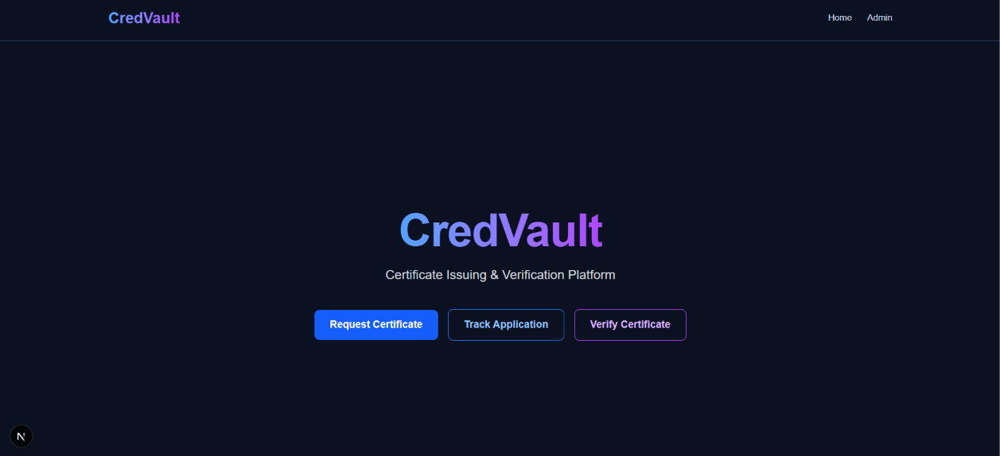
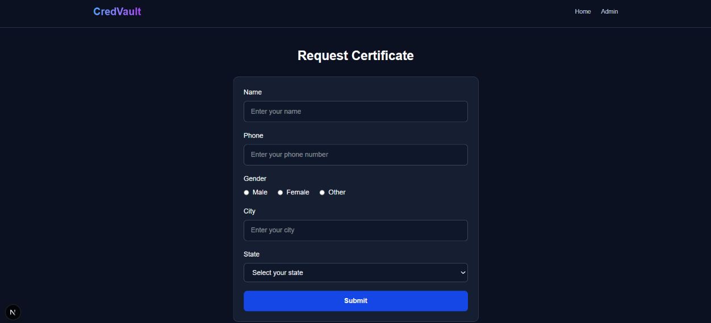
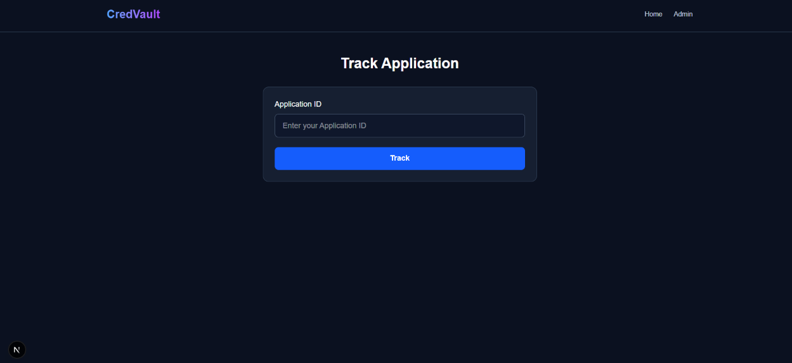
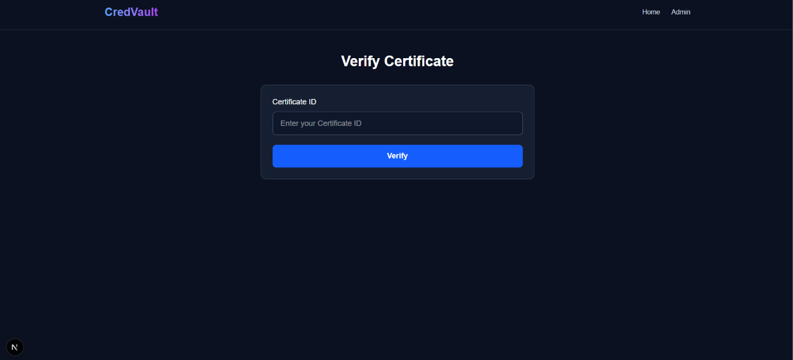
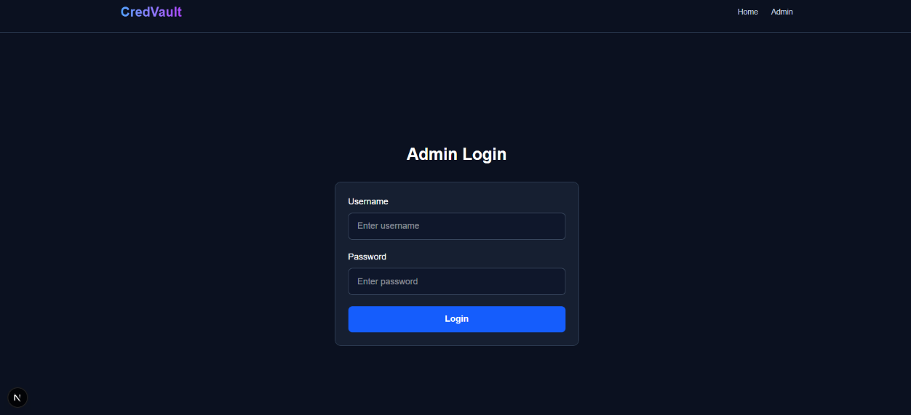
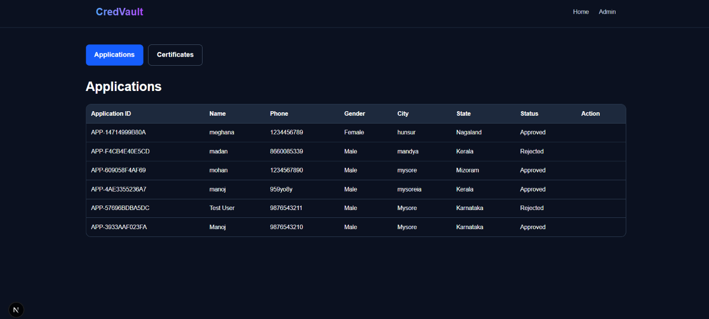
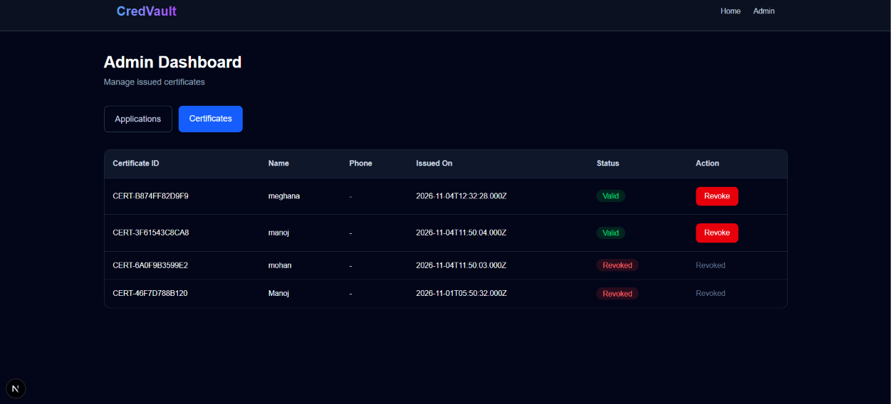

# CredVault – Certificate Issuing & Verification Platform

## Project Overview

CredVault is a full-stack Certificate Issuing and Verification Platform developed as part of the ELEVATE SDE Internship – Task 4.

The application allows citizens to request certificates, track application status and verify issued certificates. Administrators can securely log in, manage applications, approve or reject requests, view issued certificates and revoke certificates.

## Technologies Used

**Frontend**
- Next.js
- React.js
- Tailwind CSS

**Backend**
- Node.js
- Express.js

**Database**
- MySQL

**Other Tools**
- REST APIs
- VS Code
- Git and GitHub

## Features

### Citizen Features
- Submit certificate applications.
- Receive a real Application ID from the backend.
- Track application status using Application ID.
- Verify certificates using Certificate ID.
- View certificate details and status.

### Admin Features
- Admin login and authentication.
- View all applications.
- Approve applications and generate Certificate IDs.
- Reject applications.
- View issued certificates.
- Revoke certificates.

## API Integration

| Functionality | API Endpoint | Method |
|---|---|---|
| Submit Application | `/api/applications` | POST |
| Track Application | `/api/applications/track/:applicationId` | GET |
| Verify Certificate | `/api/certificates/verify/:certificateId` | GET |
| Admin Login | `/api/admin/login` | POST |
| View Applications | `/api/admin/applications` | GET |
| Approve Application | `/api/admin/applications/:applicationId/approve` | PATCH |
| Reject Application | `/api/admin/applications/:applicationId/reject` | PATCH |
| View Certificates | `/api/admin/certificates` | GET |
| Revoke Certificate | `/api/admin/certificates/:certificateId/revoke` | GET |

## Database

The application uses MySQL with three tables:

1. **Applications** – Stores application details and status.
2. **Certificates** – Stores issued certificate details and status.
3. **Admins** – Stores administrator login details.

## Project Structure

```text
elevate-sde-task-4/
│
├── frontend/
│   ├── src/
│   ├── public/
│   ├── package.json
│   └── ...
│
├── backend/
│   ├── config/
│   ├── controllers/
│   ├── middleware/
│   ├── routes/
│   ├── scripts/
│   ├── server.js
│   ├── package.json
│   └── .env.example
│
├── screenshots/
│
└── README.md
```

## Installation and Setup

### 1. Clone the Repository

```bash
git clone YOUR_GITHUB_REPOSITORY_URL
cd elevate-sde-task-4
```

### 2. Start the Backend

```bash
cd backend
npm install
```

Configure the `.env` file with your MySQL database credentials.

Start the backend:

```bash
node server.js
```

Backend runs at:

`http://localhost:5000`

### 3. Start the Frontend

Open another terminal:

```bash
cd frontend
npm install
npm run dev -- --webpack
```

Frontend runs at:

`http://localhost:3000`

## Application Screenshots

### Home Page


### Request Certificate


### Track Application


### Verify Certificate


### Admin Login


### Admin Applications


### Admin Certificates


## Application Status Values

- Pending
- Approved
- Rejected
- Valid
- Revoked

## Internship Task

**Program:** ELEVATE SDE Internship Program  
**Task:** Task 4 – Full Stack Development  
**Project:** Certificate Issuing & Verification Platform

## Conclusion

CredVault integrates the frontend developed in Task 2 with the backend developed in Task 3 to provide a working full-stack certificate issuing and verification platform using REST APIs and MySQL database storage.
