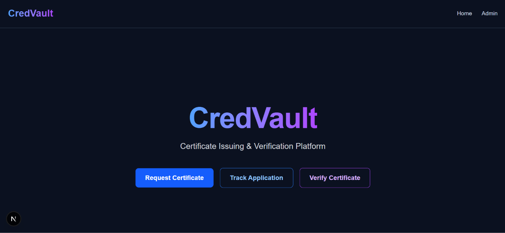
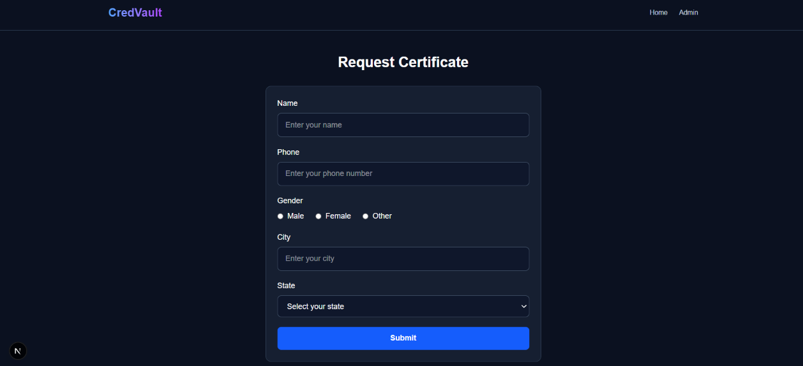
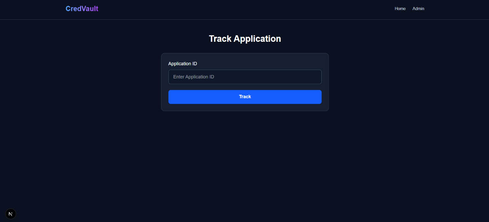
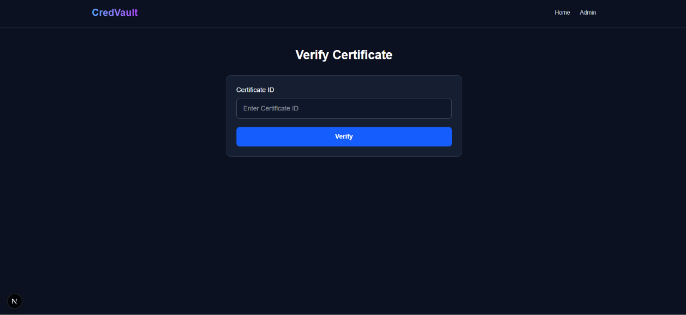
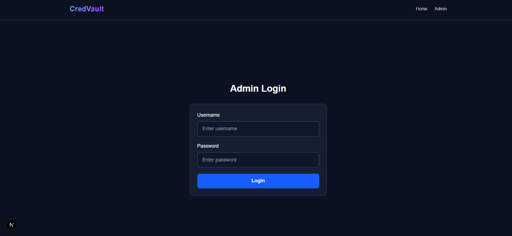
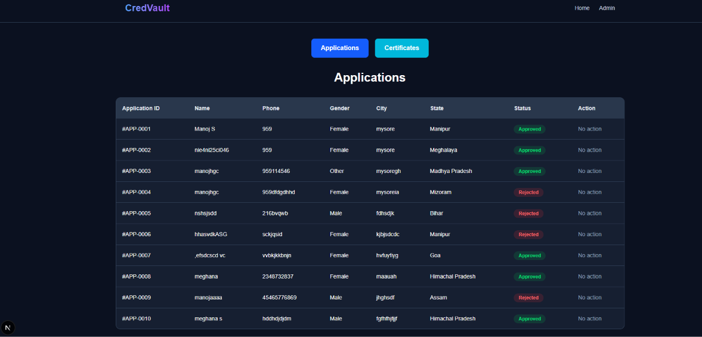
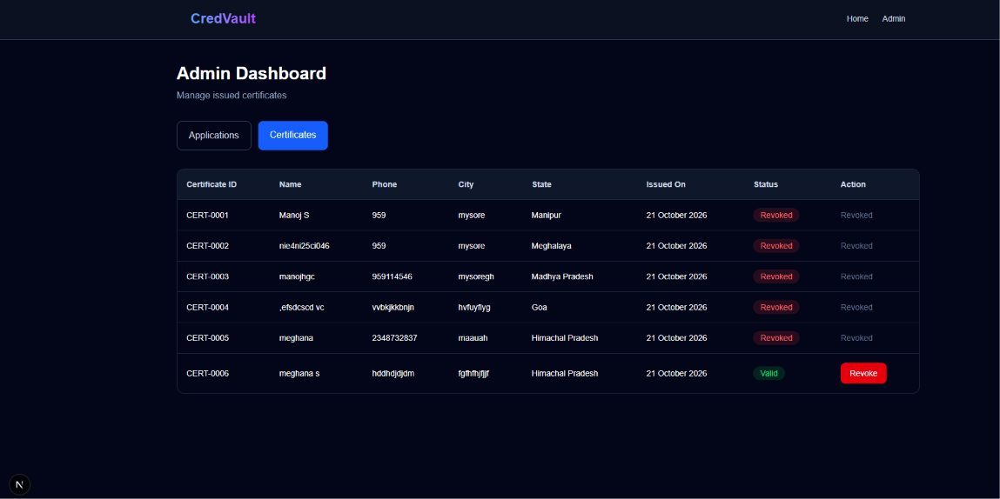

# CredVault — Certificate Issuing & Verification Platform

CredVault is a frontend web application for requesting, tracking, issuing, and verifying certificates. It also provides an admin interface to manage applications and certificates.

**Internship:** Elevate SDE Internship  
**Task:** Task 2

## Features

- **Home:** Navigation to certificate request, application tracking, and certificate verification.
- **Request Certificate:** Submit applicant details and receive an Application ID.
- **Track Application:** Check an application and its status using the Application ID.
- **Verify Certificate:** Check certificate details and whether it is valid or revoked.
- **Admin Login:** Login to the admin interface.
- **Manage Applications:** View applications and issue or reject them.
- **Manage Certificates:** View issued certificates and revoke them.

## Technologies Used

- Next.js
- React.js
- JavaScript
- Tailwind CSS
- Browser localStorage for frontend demo data

## How to Run the Project

### Prerequisites

Install Node.js and npm.

### Steps

1. Clone or download this repository.
2. Open the project folder in a terminal.
3. Install the dependencies:

   ```bash
   npm install
   ```

4. Start the development server:

   ```bash
   npm run dev
   ```

5. Open http://localhost:3000 in your browser.

## Admin Login

Demo credentials:

- **Username:** `admin`
- **Password:** `admin`

## Screenshots

### Home Page


### Request Certificate


### Track Application


### Verify Certificate


### Admin Login


### Admin Applications


### Admin Certificates


## Project Notes

- This is a frontend demonstration using dummy data.
- Application and certificate data are stored in browser localStorage.
- No backend or database is connected.
- The admin credentials are for demonstration purposes only.
